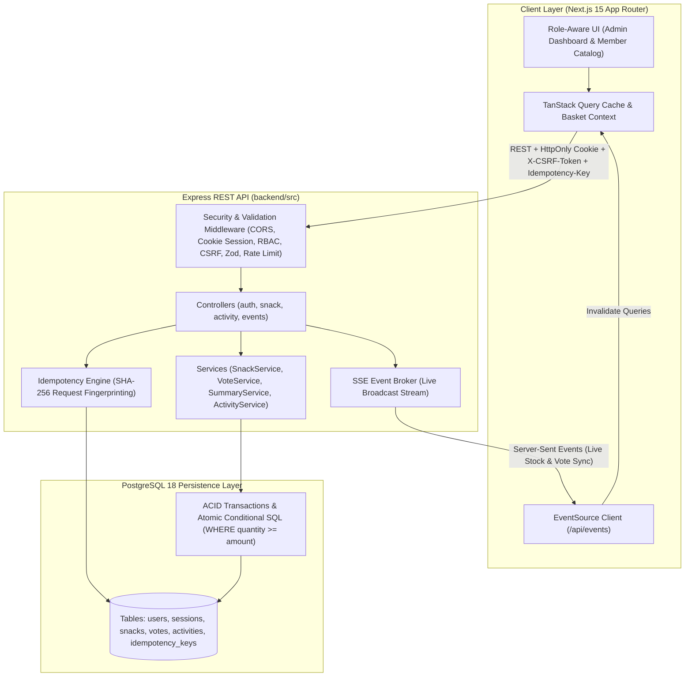

# Snack Overflow

A production-minded, full-stack office pantry and snack inventory tracker built with **Next.js 15**, **Express**, **Prisma**, and **PostgreSQL 18**. Engineered to guarantee accurate stock counts under high concurrency, enforce strict one-vote-per-person integrity at the schema level, and sync live updates across sessions.

---

## System Architecture



---

## Quick Start

### Option 1: Docker Compose (Recommended)

Run the entire stack (PostgreSQL, Prisma migrations, Express API, and Next.js frontend) in one command:

```bash
cp .env.docker.example .env.docker
docker compose --env-file .env.docker up --build
```

Seed the demo users and sample snacks once the database is healthy:

```bash
    docker compose --env-file .env.docker run --rm --entrypoint npx migration tsx prisma/seed.ts
```

- **Web App:** `http://localhost:3000`
- **API:** `http://localhost:4000/api`
- **Health Check:** `http://localhost:4000/health`

### Option 2: Local Development

**Prerequisites:** Node.js 22+, npm 10+, PostgreSQL 18 running locally.

```bash
# 1. Configure environment variables
cp .env.example .env

# 2. Install monorepo dependencies
npm install

# 3. Apply database migrations & seed demo data
npm --prefix backend run prisma:migrate
npm --prefix backend run prisma:seed

# 4. Start backend (port 4000) and frontend (port 3000)
npm run dev:backend
npm run dev:frontend
```

---

## Demo Credentials

The seed script creates one admin, one member, and six sample snacks across all four categories (`SWEET`, `SAVOURY`, `DRINK`, `HEALTHY_ISH`):

| Role | Email | Password | Capabilities |
| :--- | :--- | :--- | :--- |
| **Admin** | `admin@example.com` | `Admin1234!` | Dashboard, inventory CRUD, restocking, organization-wide audit log |
| **Member** | `member@example.com` | `Member1234!` | Catalog, single & basket consumption, voting/favourites, personal history |

Public member sign-up is also available at `/auth/register` (rate-limited to 5 attempts per 15 minutes and toggleable via `ENABLE_MEMBER_REGISTRATION`).

---

## REST API Reference

All routes are mounted under `/api`. Errors follow a single consistent contract:

```json
{
  "error": {
    "code": "INSUFFICIENT_STOCK",
    "message": "Someone beat you to the last packet! Please refresh the inventory."
  }
}
```

| Method | Endpoint | Role | Purpose |
| :--- | :--- | :--- | :--- |
| `POST` | `/api/auth/login` | Public | Authenticate user and set HTTP-only `snack_session` cookie |
| `POST` | `/api/auth/register` | Public | Self-service Member registration (bcrypt cost 12) |
| `POST` | `/api/auth/logout` | Auth | Revoke active session in DB and clear cookie |
| `GET` | `/api/auth/me` | Auth | Current authenticated user profile |
| `GET` | `/api/auth/csrf-token` | Public | Retrieve synchronizer CSRF token |
| `GET` | `/api/snacks` | Auth | Server-side filter (`category`, `status`), search, sort (`name`, `quantity`, `votes`), paginate |
| `GET` | `/api/snacks/summary` | Auth | Counts per derived status (`STOCKED`, `RUNNING_LOW`, `GONE`) + Snack of the Week |
| `GET` | `/api/snacks/favourites` | Member | Snacks voted on by the current member |
| `GET` | `/api/snacks/:id` | Auth | Fetch single snack details |
| `POST` | `/api/snacks` | Admin | Create a new snack |
| `PATCH` | `/api/snacks/:id` | Admin | Update snack name, category, or low-stock threshold |
| `DELETE` | `/api/snacks/:id` | Admin | Remove snack while preserving historical activity rows |
| `POST` | `/api/snacks/:id/consume` | Member | Atomic stock decrement (`{ amount }`) + activity log; supports `Idempotency-Key` |
| `POST` | `/api/snacks/consume-basket` | Member | All-or-nothing multi-snack consumption transaction; supports `Idempotency-Key` |
| `POST` | `/api/snacks/:id/restock` | Admin | Transactional stock increment (`{ amount }`) + activity log |
| `POST` | `/api/snacks/:id/vote` | Member | Cast vote (enforced unique per user + snack) |
| `DELETE` | `/api/snacks/:id/vote` | Member | Remove vote |
| `GET` | `/api/activities` | Admin | Paginated pantry-wide audit log |
| `GET` | `/api/activities/me` | Member | Paginated personal consumption history |
| `GET` | `/api/events` | Auth | Server-Sent Events (SSE) live update stream |

Full request/response contracts are documented in [docs/API_SPEC.md](docs/API_SPEC.md).

---

## Schema & Data Integrity

Managed with Prisma ORM against PostgreSQL 18 (see [docs/DATABASE.md](docs/DATABASE.md)):

- **`users`**: UUID PK, unique `email`, bcrypt `passwordHash`, `role` (`ADMIN | MEMBER`).
- **`sessions`**: Stateful server-side session records storing SHA-256 `tokenHash`, `expiresAt`, and `revokedAt` for instant logout/revocation.
- **`snacks`**: Unique `name`, `category` (`SWEET | SAVOURY | DRINK | HEALTHY_ISH`), `quantity` with `CHECK (quantity >= 0)`, `lowStockThreshold` (default `5`) with `CHECK ("lowStockThreshold" >= 0)`. **Status is derived dynamically** (`STOCKED` when `quantity > threshold`, `RUNNING_LOW` when `1 <= quantity <= threshold`, `GONE` when `quantity = 0`)—never stored.
- **`votes`**: Composite `UNIQUE (userId, snackId)` guaranteeing one vote per person per snack even under concurrent requests.
- **`activities`**: Immutable audit log with `CHECK (amount > 0)`. Uses `ON DELETE RESTRICT` on `userId` and `ON DELETE SET NULL` on `snackId` alongside a `snackName` snapshot so deleting a snack never corrupts historical logs.
- **`idempotency_keys`**: Composite `UNIQUE (userId, key)` with SHA-256 payload fingerprint and cached response so retried consume requests are never double-counted.

---

## Concurrency & Authorization

### Preventing Race Conditions
Stock decrements never use read-then-write in application memory. Instead, `consumeSnack` and `consumeBasket` execute a single atomic conditional SQL statement inside a PostgreSQL transaction:

```sql
UPDATE "snacks"
SET "quantity" = "quantity" - $1, "updatedAt" = NOW()
WHERE "id" = $2::uuid AND "quantity" >= $1
RETURNING *;
```

PostgreSQL serializes concurrent writers via row-level locks. If 10 users request the last 3 packets simultaneously, exactly 3 updates match `quantity >= 1` and succeed; the other 7 match 0 rows and return `409 Conflict`. The `activities` record is inserted in the exact same transaction.

### Authorization & Security
- **Server-side RBAC:** Every protected route validates the session cookie against PostgreSQL (`revokedAt IS NULL AND expiresAt > NOW()`) and checks `requireAdmin` / `requireMember` middleware. Admins cannot hit member consumption endpoints and members cannot hit admin endpoints.
- **CSRF Defense:** Mutating requests require Origin/Referer validation plus a synchronizer token (`X-CSRF-Token` header paired with signed cookie).
- **Input Validation:** Every request body and query parameter is parsed through strict Zod schemas before reaching controllers.
- **Zero Secrets in Repo:** Only `.env.example` and `.env.docker.example` templates are committed.

---

## Design Note: Decisions, Trade-offs & 100× Scale

### Key Decisions & Trade-offs
1. **Atomic SQL over Optimistic Locking:** Conditional `UPDATE ... WHERE quantity >= amount` eliminates retry loops and external lock services (like Redis) while guaranteeing zero negative stock. The trade-off is row-level write serialization on hot snacks.
2. **Stateful DB Sessions over Stateless JWTs:** Storing hashed session tokens in PostgreSQL allows immediate revocation on logout or compromise, at the cost of one indexed primary-key/unique lookup per request.
3. **SSE over WebSockets:** Inventory updates are server-to-client broadcasts. SSE works over standard HTTP with native browser reconnection and zero proxy upgrade friction. The trade-off is unidirectional transport (mutations remain REST `POST`s).
4. **In-Memory SSE Broker:** Zero operational overhead for a single-instance deployment, trading off horizontal fan-out across multiple API replicas.

### What Would Break First at 100× Users?
1. **In-Memory SSE Fan-Out:** Scaling to multiple API containers behind a load balancer would isolate SSE clients per container. *Fix:* Publish events to Redis Pub/Sub (or PostgreSQL `LISTEN/NOTIFY`) so every replica fans out to its connected clients.
2. **PostgreSQL Connection Pool Exhaustion:** Hundreds of concurrent API connections would saturate `max_connections`. *Fix:* Introduce PgBouncer in transaction pooling mode.
3. **Hot-Row Lock Contention:** Simultaneous bursts on a single popular snack would queue on one row lock. *Fix:* Keep transactions minimal (no network I/O inside `prisma.$transaction`) and add short lock timeouts with clean `409` fallback.
4. **In-Memory Rate Limiting:** `express-rate-limit` memory store does not share counters across replicas. *Fix:* Back rate limiting with Redis.
5. **Summary & Offset Pagination Load:** On-the-fly aggregations on `GET /api/snacks/summary` and high-offset queries on `activities` would increase read I/O. *Fix:* Add short-TTL Redis caching invalidated on stock/vote events, read replicas, and cursor-based pagination.

---

## Testing & Quality Checks

All backend integration, concurrency, idempotency, and security tests run against a real PostgreSQL test database (`snack_overflow_test`):

```bash
npm run test            # All backend + frontend Vitest suites
npm run typecheck       # Strict TypeScript checks across workspaces
npm run lint            # ESLint for backend and frontend
npm run build           # Production TypeScript & Next.js builds
npm run format          # Format codebase with Prettier
```

---

## Documentation Index

- [Architecture & Concurrency](docs/ARCHITECTURE.md)
- [API Specification](docs/API_SPEC.md)
- [Database Schema](docs/DATABASE.md)
- [UI Design System](docs/DESIGN_SYSTEM.md)
