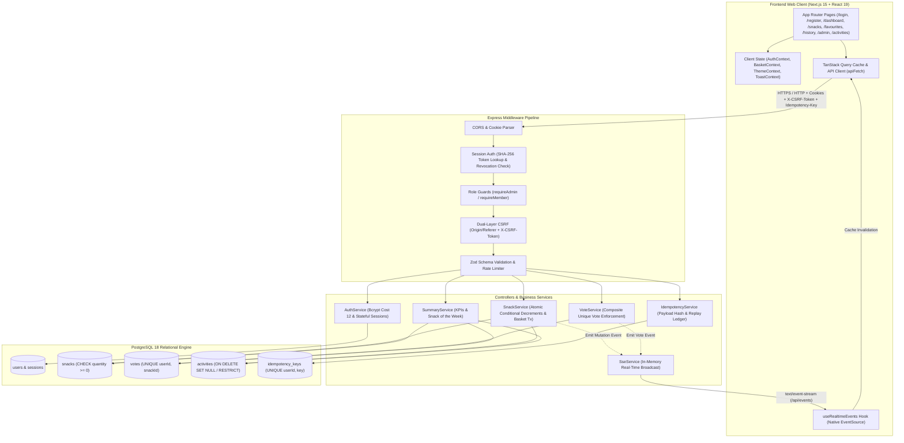
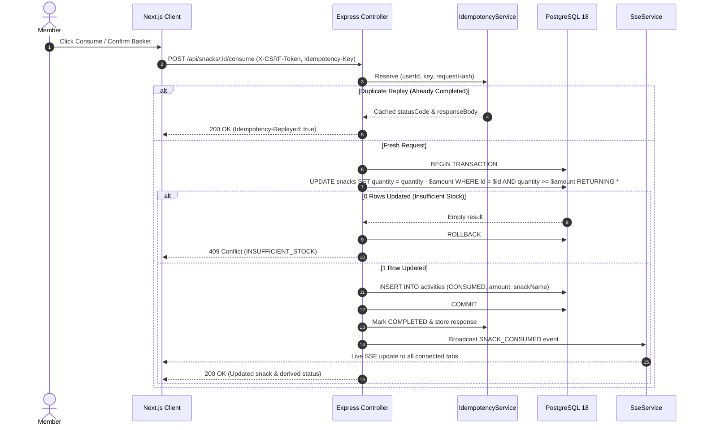

# System Architecture

Snack Overflow is structured as an npm workspaces monorepo with a Next.js 15 frontend (`frontend/`) and an Express + Prisma REST API (`backend/`) backed by PostgreSQL 18.

## Layered Architecture Diagram



## Atomic & Idempotent Consumption Sequence



## Concurrency & Idempotency Flow

1. **Single & Basket Consumption:**
   - The client generates a UUID `Idempotency-Key` per logical action.
   - `idempotencyService` reserves `(userId, key)` in `idempotency_keys` along with a SHA-256 hash of the request payload.
   - Inside `prisma.$transaction`, each snack executes:
     ```sql
     UPDATE "snacks"
     SET "quantity" = "quantity" - $amount, "updatedAt" = NOW()
     WHERE "id" = $snackId::uuid AND "quantity" >= $amount
     RETURNING *;
     ```
   - If any item returns 0 rows, the transaction throws `InsufficientStockError` (`409 Conflict`) and rolls back completely.
   - On success, `activities` rows are written in the same transaction, the idempotency record is marked `COMPLETED` with the serialized response, and an SSE event is broadcast.
   - Replaying the same key with the same payload returns the cached response (`Idempotency-Replayed: true`) without touching stock or emitting duplicate SSE events. Reusing a key with a different payload returns `409 IDEMPOTENCY_KEY_PAYLOAD_MISMATCH`.

2. **One Vote Per Person:**
   - Enforced directly by PostgreSQL `UNIQUE ("userId", "snackId")` on `votes`. Concurrent duplicate `POST /api/snacks/:id/vote` calls result in a `P2002` / `23505` constraint error mapped cleanly to `409 Conflict`.

## Real-Time Synchronization (SSE)

- Authenticated clients open `GET /api/events`.
- `SseService` maintains active response streams and sends periodic heartbeat pings.
- Mutations (`SNACK_CREATED`, `SNACK_UPDATED`, `SNACK_DELETED`, `SNACK_CONSUMED`, `SNACK_RESTOCKED`, `VOTE_ADDED`, `VOTE_REMOVED`) broadcast lightweight JSON payloads.
- The frontend `useRealtimeEvents` hook invalidates relevant TanStack Query caches (`snacks`, `summary`, `favourites`, `admin-snacks`, `admin-activities`, `my-activities`) so open tabs stay synchronized automatically.
