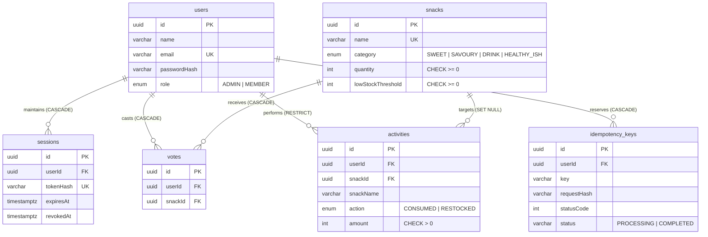

# Database Schema

Snack Overflow uses **PostgreSQL 18** managed through **Prisma ORM** (`backend/prisma/schema.prisma`). Business invariants are enforced directly in the relational engine.

## Entity-Relationship Diagram

## Tables

### 1. `users`
- `id` (`UUID`, PK)
- `name` (`VARCHAR(100)`, required)
- `email` (`VARCHAR(255)`, unique, required)
- `passwordHash` (`VARCHAR(255)`, bcrypt cost 12)
- `role` (`Role` enum: `ADMIN | MEMBER`, default `MEMBER`)
- `createdAt`, `updatedAt` (`TIMESTAMPTZ`)

### 2. `sessions`
- `id` (`UUID`, PK)
- `userId` (`UUID`, FK → `users.id`, `ON DELETE CASCADE`)
- `tokenHash` (`VARCHAR(64)`, unique SHA-256 hash)
- `expiresAt` (`TIMESTAMPTZ`, indexed)
- `revokedAt` (`TIMESTAMPTZ`, nullable)
- `userAgent`, `ipAddress` (audit metadata)

### 3. `snacks`
- `id` (`UUID`, PK)
- `name` (`VARCHAR(120)`, unique)
- `category` (`SnackCategory` enum: `SWEET | SAVOURY | DRINK | HEALTHY_ISH`, indexed)
- `quantity` (`INT`, default `0`, `CHECK (quantity >= 0)`)
- `lowStockThreshold` (`INT`, default `5`, `CHECK ("lowStockThreshold" >= 0)`)
- `createdAt`, `updatedAt` (`TIMESTAMPTZ`)

**Derived Status:** Status is never persisted. It is computed dynamically in SQL filters and response mappers:
- `quantity === 0` → `GONE`
- `1 <= quantity <= lowStockThreshold` → `RUNNING_LOW`
- `quantity > lowStockThreshold` → `STOCKED`

### 4. `votes`
- `id` (`UUID`, PK)
- `userId` (`UUID`, FK → `users.id`, `ON DELETE CASCADE`)
- `snackId` (`UUID`, FK → `snacks.id`, `ON DELETE CASCADE`)
- `createdAt` (`TIMESTAMPTZ`)
- **Constraint:** `UNIQUE ("userId", "snackId")` prevents duplicate votes under concurrency.

### 5. `activities`
- `id` (`UUID`, PK)
- `userId` (`UUID`, FK → `users.id`, `ON DELETE RESTRICT`)
- `snackId` (`UUID`, nullable, FK → `snacks.id`, `ON DELETE SET NULL`)
- `snackName` (`VARCHAR(120)`, historical snapshot)
- `action` (`ActivityAction` enum: `CONSUMED | RESTOCKED`)
- `amount` (`INT`, `CHECK (amount > 0)`)
- `createdAt` (`TIMESTAMPTZ`, indexed descending)

### 6. `idempotency_keys`
- `id` (`UUID`, PK)
- `key` (`VARCHAR(255)`)
- `userId` (`UUID`, FK → `users.id`, `ON DELETE CASCADE`)
- `operation` (`VARCHAR(100)`)
- `requestHash` (`VARCHAR(64)`, SHA-256 of payload)
- `statusCode` (`INT`, nullable)
- `responseBody` (`TEXT`, nullable)
- `status` (`VARCHAR(20)`: `PROCESSING | COMPLETED`)
- `expiresAt` (`TIMESTAMPTZ`, indexed)
- **Constraint:** `UNIQUE ("userId", "key")`
